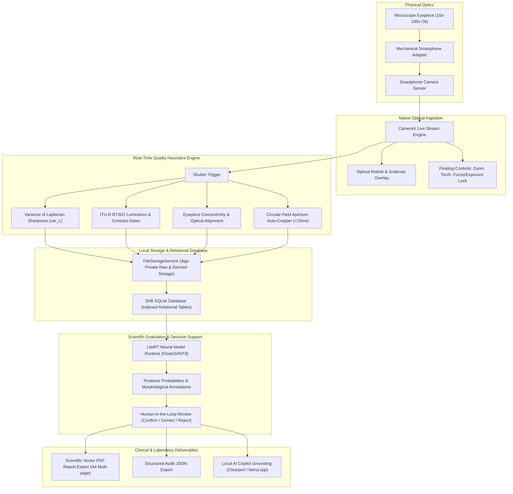
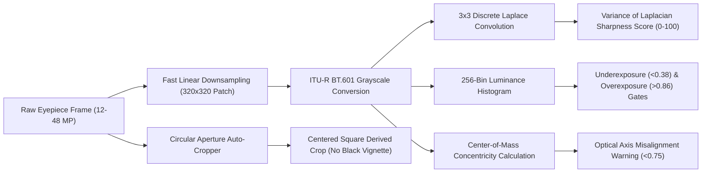
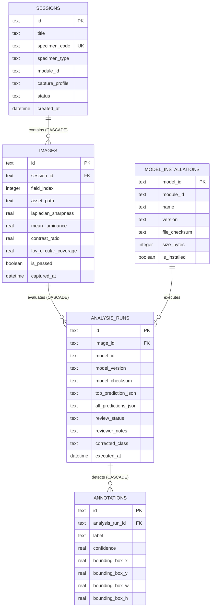

# MICROTRACE

**Smartphone-Assisted Digital Microscopy Workstation with On-Device Computer Vision**

> *Make every microscope more intelligent.*

[](https://github.com/Adams-404/microtrace/releases/latest)
[](https://github.com/Adams-404/microtrace/actions/workflows/release.yml)
[](https://flutter.dev)
[](https://dart.dev)
[](https://drift.simonbinder.eu/)
[](#optical-pipeline)
[](#scientific-integrity)

---

## 🚀 Quick Download & Phone Installation

You can download and install the latest compiled Android APK directly onto your smartphone:

👉 **[Download Latest Android APK (GitHub Releases)](https://github.com/Adams-404/microtrace/releases/latest)**

1. Download the `.apk` on your Android device (or transfer via USB).
2. Tap the file to install (allow *"Install unknown apps"* for your browser or file manager if prompted).
3. Mount the smartphone onto your microscope eyepiece using a universal mechanical adapter and launch **MICROTRACE**.

---

## 1. Executive Summary

**MICROTRACE** is an offline-first digital laboratory workstation designed to transform standard optical light microscopes into intelligent diagnostic decision-support instruments. By pairing commodity smartphones with standard microscope eyepieces, MICROTRACE delivers:

- **100% Offline Relational Persistence**: Zero mandatory internet connectivity. All sessions, images, model runs, annotations, and reviewer sign-offs are committed to an ACID-compliant local **Drift SQLite** database.
- **Hardware-Accelerated CameraX Streaming**: Native camera bridge featuring hardware-stepped optical sensor zoom (`1.0x`, `2.0x`, `4.0x`), exposure and focus lock, auxiliary torch illumination, and exposure compensation.
- **Real-Time Quality Assessment (<15 ms SLA)**: Instant feedback evaluating Variance of Laplacian defocus blur, ITU-R BT.601 luminance gates, optical adapter concentricity, and circular aperture auto-cropping.
- **Vector PDF & Structured Audit Export**: Multi-page vector laboratory reports (A4 format) with embedded quality histograms, model checksums, and microscopist verification signature blocks.
- **Human-in-the-Loop Safeguards**: Strict cryptographic and semantic separation between automated AI proposals and human-verified diagnostic decisions.
- **Air-Gapped Local AI Assistant**: On-device language model integration grounded on session facts via local loopback (`http://127.0.0.1:8080/v1`).

---

## 2. End-to-End System Architecture



---

## 3. Optical Pipeline & Quality Heuristics



### Mathematical Formulations

1. **Variance of Laplacian (Focus Heuristic)**:
   Convolution with discrete 3x3 Laplace operator $\mathbf{K} = \begin{bmatrix} 0 & 1 & 0 \\ 1 & -4 & 1 \\ 0 & 1 & 0 \end{bmatrix}$ computes spatial edge response $L(x, y)$. The calibrated score is:
   $$\text{Score}_{sharpness} = 100 \cdot \left( 1 - \exp\left( -\frac{\sqrt{\text{Var}(L)}}{22.0} \right) \right)$$
   Fields scoring $< 70.0$ trigger an actionable refocus warning.

2. **Luminance & Dynamic Range**:
   Luminance computed per ITU-R BT.601:
   $$Y = 0.299R + 0.587G + 0.114B$$
   Mean normalized luminance gates enforce $0.38 \le \bar{Y} \le 0.86$, preventing burned-out or unilluminated frames.

3. **Adapter Concentricity**:
   Center of illuminated mass $(\bar{x}, \bar{y})$ deviation from sensor center determines alignment score:
   $$\text{Concentricity} = 1.0 - 0.8 \cdot \sqrt{\left(\frac{\bar{x} - w/2}{w/2}\right)^2 + \left(\frac{\bar{y} - h/2}{h/2}\right)^2}$$

---

## 4. Offline Relational Database Schema (Drift SQLite)

MICROTRACE replaces volatile mock states with an indexed relational schema managed by **Drift** (`drift_flutter`):



---

## 5. Workstation Screen Inventory

MICROTRACE provides 14 specialized workstation screens designed in the **Darkroom-First** palette (`#06080D` surface, `#C8F751` bioluminescent lime signal):

1. **Dashboard (`/`):** Workspace telemetry, quick session initialization, recent slide records, module readiness, and instant theme switching.
2. **New Microscopy Session (`/new-session`):** Specimen registration capturing slide IDs, preparation mounts, optical objectives, and microscopist initials.
3. **Capture Workspace (`/capture/:sessionId`):** Native CameraX streaming viewport, interactive pinch/zoom, reticle graticule overlay (25 µm scale), real-time focus meter, optical controls (zoom, torch, locks, EV), and filmstrip.
4. **Image Review (`/session/:id/image/:imgId`):** High-resolution pinch/pan inspection, objective quality gates (Sharpness, Luminance, Eyepiece Alignment), usability flags, and operator notes.
5. **Analysis Workspace (`/session/:id/image/:imgId/analysis`):** Multi-stage on-device LiteRT neural inference execution.
6. **Results & Scientific Review (`/session/:id/image/:imgId/results`):** Decision-support interface with ROI bounding box overlays, confidence distributions, and human sign-off actions (**Confirm**, **Correct**, **Reject**, **Needs Expert Review**).
7. **Session History (`/sessions`):** Searchable laboratory archive with status filters and specimen cards.
8. **Session Details (`/session/:id`):** Microscopic field gallery, specimen metadata table, and session-level observation summaries.
9. **Report Preview (`/session/:id/report`):** Multi-page vector PDF report generation with embedded quality histograms, model checksums, and signature blocks.
10. **Modules Library (`/modules`):** Module catalog highlighting Mycology (Installed & Ready) alongside roadmap modules (Parasitology, Malaria Smear, Hemocytometry).
11. **Model Library (`/models`):** On-device LiteRT neural model manager showing model sizes, SHA-256 checksums, and offline update workflows.
12. **Workstation Settings (`/settings`):** Real-time theme switcher (**Darkroom**, **AMOLED**, **Daylight**), Local AI server configuration, local storage management, and scientific disclaimers.
13. **Local AI Copilot (`/assistant`):** Streaming chat with the phone's on-device model grounded on verified session records via local loopback.
14. **Onboarding (`/onboarding`):** Guided first-launch experience detailing optical microscope alignment, on-device LiteRT architecture, and human review responsibilities.

---

## 6. Local Development & Web Preview

To run and preview MICROTRACE in your browser (Brave / Chrome) without running release builds locally:

```bash
# Clone the repository
git clone https://github.com/Adams-404/microtrace.git
cd microtrace

# Fetch dependencies
flutter pub get

# Launch web server preview on port 3000
flutter run -d web-server --web-port 3000
```

Open **`http://localhost:3000`** in your browser.

---

## 7. Testing & Verification

MICROTRACE maintains rigorous static analysis and automated test coverage across database persistence, optical quality heuristics, PDF generation, and UI components:

```bash
# Verify formatting
dart format --output=none --set-exit-if-changed .

# Static analysis (0 errors, 0 warnings, 0 lints)
flutter analyze

# Execute test suite (24 passing unit & widget tests)
flutter test
```

### Verified Test Suites
- `test/database_persistence_test.dart`: Drift SQLite relational CRUD, cascade integrity, query speed (<15 ms).
- `test/image_quality_service_test.dart`: Variance of Laplacian blur discrimination, luminance gates, circular auto-cropping, <300 ms SLA.
- `test/pdf_report_service_test.dart`: Multi-page vector PDF generation, checksum embedding, signature blocks (<350 ms).
- `test/capture_workspace_test.dart`: Hardware camera controls, reticle overlays, calibration fallback mode, shutter persistence.
- `test/stream_parser_test.dart` & `test/local_ai_service_test.dart`: Local AI SSE delta streaming and error handling.

---

## 8. Continuous Integration & Release Automation

Automated builds and releases are managed via **GitHub Actions** (`.github/workflows/release.yml`). A build job triggers on:
- Pushing to `main` with `release` in the commit message (e.g. `release: v0.2.0`).
- Pushing a version tag (`v*`).
- Manual trigger via `workflow_dispatch`.

Each run executes `flutter analyze`, `flutter test`, builds the Android release APK and Web bundle, and automatically attaches the compiled APK to the GitHub Release.

---

## 9. Scientific Integrity & Disclaimers

> [!IMPORTANT]
> **RESEARCH USE ONLY (RUO)**: MICROTRACE is an investigative scientific decision-support tool. It does NOT provide autonomous medical diagnoses. All machine learning predictions are assistive proposals that require explicit verification and sign-off by a qualified microscopist or pathologist before clinical action.
